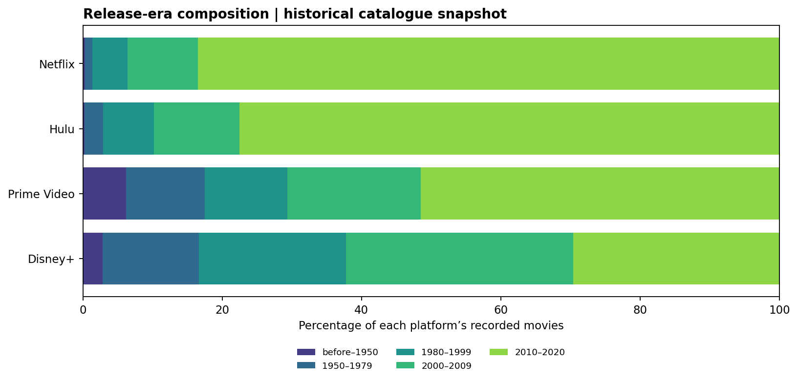
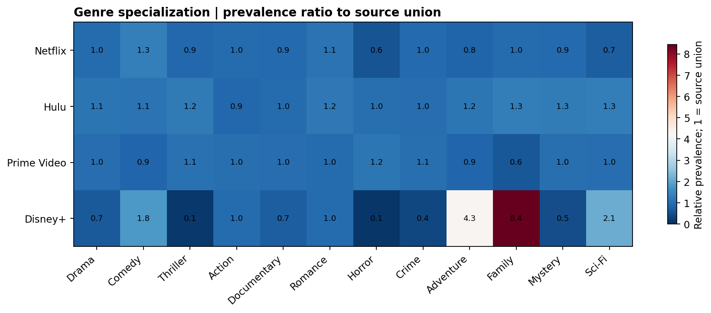
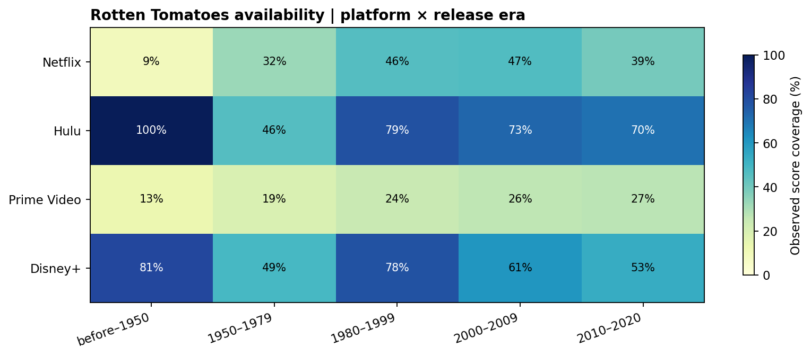

# Inside the Streaming Library

**Historical streaming catalogue analytics**
**Project owner:** Cyril James Lunzaga

## Research purpose

A reproducible, descriptive investigation of catalogue coverage, overlap, genre variety, observed scores, metadata completeness and release-year composition across four recorded streaming platform flags. It asks whether membership count, unique represented movie records, and genre diversity tell the same story. This study analyzes **one undated, historical source snapshot**; it does not describe current platform availability, viewership, subscriber preferences, market share, longitudinal catalogue growth or causal effects.

## Provenance and unit of analysis

- Original dataset attribution: [Ruchi Bhatia — Movies on Netflix, Prime Video, Hulu and Disney+](https://www.kaggle.com/datasets/ruchi798/movies-on-netflix-prime-video-hulu-and-disney).
- Analyzed 17-column mirror: [SalimAmarti/OTT_movies_Project](https://github.com/SalimAmarti/OTT_movies_Project/blob/master/MoviesOnStreamingPlatforms_updated.csv).
- Download exact input: `https://raw.githubusercontent.com/SalimAmarti/OTT_movies_Project/master/MoviesOnStreamingPlatforms_updated.csv`.
- Raw file SHA-256: `c7a1b949495c35879b038c97f92bbe233d1b0b348719f3d4a8020927645c0c27`.
- Local path: `data/raw/historical_streaming_movies.csv` (Git-ignored; not included in this repository).
- Observation date is unknown. The mirror is not interchangeable with a current version of the source's Kaggle listing. Review third-party usage/redistribution terms separately before sharing source data.
- Source movie ID represents one archived record, **not** an independently verified global work ID. The 16,744 unique source records carry 17,381 non-exclusive platform flags.

## Pipeline and analytical coverage

| Phase | Methods and outputs | Review status |
|---|---|---|
| 01 | Source viability, 17-column schema, SHA-256, provenance | Reviewed |
| 02 | Record-level cleaning, platform membership and genre tables, invalid/missing-value validation | Reviewed |
| 03 | EDA, release-era mix, ratings, runtime, multi-label genre prevalence and figures | Reviewed |
| 04 | Directional/Jaccard overlap, Simpson diversity and metadata completeness comparisons | Reviewed |
| 05 | Country/language label normalization, recorded exclusivity, corrected literal `None` language sentinel | Reviewed |
| 06 | Integrated report, notebook, interactive Streamlit dashboard | Local tests and user execution reviewed |
| 07A | Exact 16-coalition Shapley, Shannon diversity sensitivity and equal-size resampling | 79-test local and output review passed |
| 07B–C | Comprehensive final report, documentation, clean reproduction and controlled release | Final release signoff pending |

Core methods are implemented in `streaming_library/` with tests in `tests/`. Explanations and research design are in `docs/`. Narrative notebook: `notebooks/integrated_research.ipynb`. Local dashboard: `streaming_library/dashboard.py`.

## Key source-level findings

- Platform memberships: **Netflix 3,560**, **Hulu 903**, **Prime Video 12,354**, **Disney+ 564**. They sum to **17,381**, not 16,744, because 627 records appear on more than one represented platform.
- Exact Shapley source-record allocations: **Netflix 3,372.667**, **Hulu 769.500**, **Prime Video 12,054.500**, **Disney+ 547.333** (sum **16,744**). This is fractional accounting of the represented union, not market share, commercial value or exclusive rights.
- Recorded country labels exist for 16,309 source movie records and at least one named-language label for 16,130. Source `None` language tokens are excluded from *named-language* analyses, not altered in the raw file.
- Only **5,158 / 16,744** source records have an observed Rotten Tomatoes value. Observed rating means are not platform-quality comparisons.
- Shannon effective genre diversity changes under alternative multi-label weighting rules. Equal-size draws of 564 source records per platform (200 each) are descriptive size-sensitivity, not population uncertainty intervals; Disney+ draws include the whole represented catalogue each time.

The source-grounded comprehensive findings are generated locally by `python -m streaming_library.final_research`. This report, tables and figures are intentionally ignored by Git; see the reproduction instructions below. The calculations should not be interpreted beyond the source snapshot.

## Reproduce locally

Python 3.9+ is supported by the core standard-library analytics code (the project has also been exercised in later Python environments). Matplotlib generates PNG figures; Streamlit is optional for the dashboard. Use an isolated virtual environment where practical.

```powershell
python -m pip install -r requirements.txt
python -m pip install -r requirements-dashboard.txt
```

Download the **exact** source mirror into `data/raw/historical_streaming_movies.csv` and verify the stated SHA-256; do not substitute another release with different columns or ordering. Run in a fresh workspace (or archive existing `outputs/` first):

```powershell
python -m streaming_library.source_audit
python -m streaming_library.preparation
python -m streaming_library.eda
python -m streaming_library.comparative
python -m streaming_library.metadata_analytics --output-dir outputs/phase05_metadata_reviewed
```

The above command generates corrected historical language-sentinel outputs into `outputs/phase05_metadata_reviewed` (not the original Phase 05 folder). Consult `docs/phase05_metadata_method.md` for the accepted token policy. Then run:

```powershell
python -m streaming_library.integrated
python -m streaming_library.phase07_methods
python -m streaming_library.final_research
python -m unittest discover -s tests -p "test_*.py" -q
python analysis.py
python -m streamlit run streaming_library/dashboard.py
```

The notebook is `notebooks/integrated_research.ipynb` (use Run All after generating outputs). Each stage refuses to overwrite its output directory. The source audit can update `docs/phase01_source_review.md`; inspect Git changes if reproducing it in a working checkout. The final report writes `outputs/phase07_final/research_findings.md`. Do not assume `analysis.py` alone revalidates Phases 05–07: those are additionally checked by later modules and the final report generator.

## QA, interpretation, and release controls

- Core dataset: 16,744 source records, 17,381 non-exclusive memberships, 39,098 genre assignments. Input and stage outputs have SHA-256 fingerprints.
- The project deliberately leaves an implausible source runtime of 1,256 minutes (Colorado, 1940, source ID 13180) invalid for numeric analysis rather than guessing a correction.
- Source labels are imperfect and sometimes multi-valued. Country labels do not establish streaming geography; language labels do not establish audio availability; film release year is not platform listing date.
- Rated and unrated subsets differ. Averages are observed-only. Equal-size resampling and overlap statistics are descriptive, not external significance tests.
- Before GitHub main-branch release, independently inspect figures and the expanded notebook, reproduce the pipeline, review all tracked files and licensing/attribution, and verify public owner credit. **Do not upload the entire local working directory**, including `.git`, raw source CSV and cached outputs, as a release artifact.

**Project owner:** Cyril James Lunzaga
## Advanced Analytical Atlas — additional research

This repository also includes **eight further research tables, six reproducible analytical figures, a separate interactive analytical atlas, and a 17-cell research notebook**. These extend the reviewed overlap, Shapley and Shannon analyses instead of replacing them. All results come from the same undated historical movie source.







Highlights from the archived data: Netflix's 2010–2020 share is **83.48%**, versus **51.47%** for Prime Video. Disney+ has a **Family** genre prevalence ratio of approximately **8.43×** the unique-source union rate. Recorded Rotten Tomatoes coverage for 2010–2020 movies varies from **27.28%** for Prime Video to **70.14%** for Hulu. These are descriptive differences within the archived records, not up-to-date catalogue statistics or quality rankings.

The release-era standardized IMDb comparison is an additional *observed-only sensitivity exercise*: it applies the unique-source pooled film release-era weights to each platform's era-specific observed scores. Missing-score selection remains unadjusted; no causal or quality claim follows.

- Method definitions and limitations: [`docs/advanced_analytical_atlas.md`](docs/advanced_analytical_atlas.md)
- Source-grounded expanded findings: [`docs/advanced_findings.md`](docs/advanced_findings.md)
- All six figures: [`assets/advanced/`](assets/advanced/)
- Notebook: [`notebooks/advanced_analytical_atlas.ipynb`](notebooks/advanced_analytical_atlas.ipynb)
- Generate tables, charts and QA: `python -m streaming_library.advanced_analysis`
- Open the analytical atlas: `python -m streamlit run streaming_library/advanced_dashboard.py`

The `outputs/phase08_advanced/` folder is generated locally and excluded from Git; tracked plots are derived visual artifacts, not redistributed raw third-party source records.
